# Как пустить торрент-клиент мимо VPN в Happ и INCY

Торрент-клиент лучше пускать в интернет напрямую, а весь остальной трафик оставить в VPN. Так раздачи качаются на полной скорости и не нагружают VPN-сервер. Ниже пошагово для Happ и INCY на компьютере и Android.

> На iPhone и iPad так сделать нельзя: ни Happ, ни INCY не умеют выбирать приложения на iOS. Подробнее в конце статьи.

## Перед началом

1. Обновите Happ или INCY до последней версии.
2. Проверьте, что VPN подключается.
3. Полностью закройте торрент-клиент, включая значок в трее возле часов.
4. Если раньше привязывали торрент-клиент к VPN, отмените это. В qBittorrent: **Настройки → Дополнительно → Сетевой интерфейс → «Любой интерфейс»**.

---

## Happ на компьютере (Windows, macOS, Linux)

На Windows запускайте Happ от имени администратора: правой кнопкой по ярлыку → «Запуск от имени администратора». Без этого режим TUN не заработает.

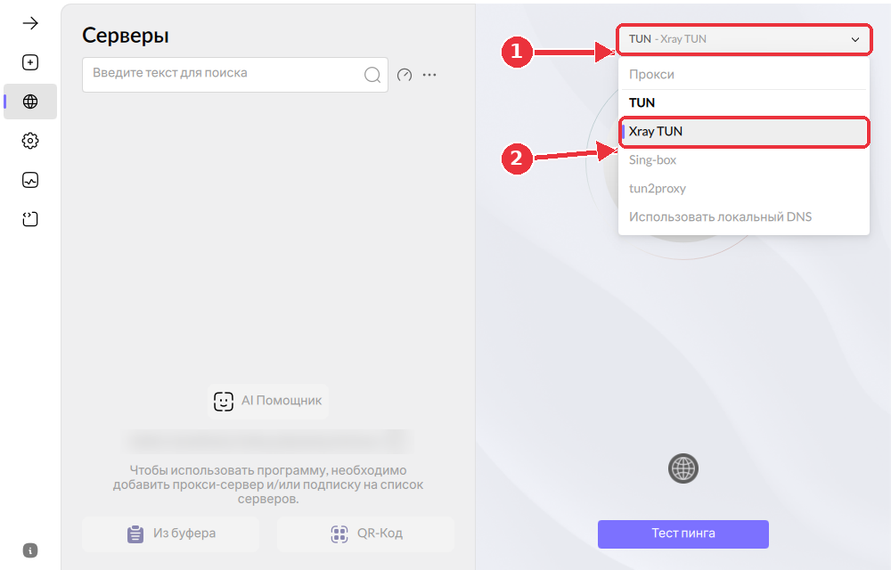
*Шаги 1–2: включаем режим TUN*

**1.** На главном экране откройте список режимов вверху справа.  
**2.** Выберите **TUN → Xray TUN**. В режиме «Прокси» исключение приложений не нужно и не работает: торрент-клиенты системный прокси обычно игнорируют.

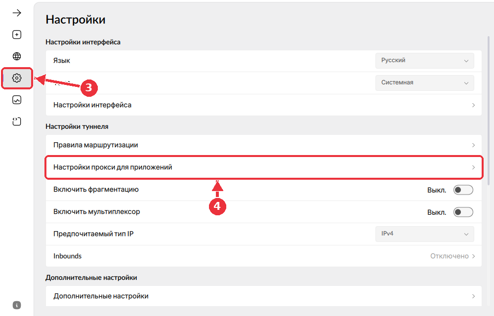
*Шаги 3–4: открываем настройки прокси для приложений*

**3.** Нажмите шестерёнку слева — откроются **Настройки**.  
**4.** В блоке «Настройки туннеля» выберите **Настройки прокси для приложений**.

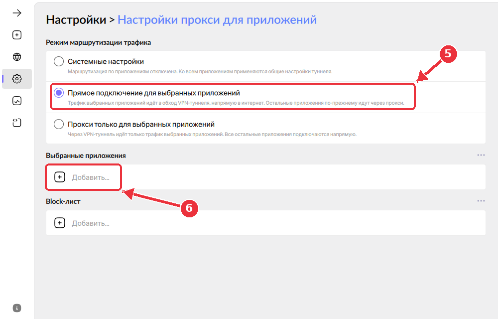
*Шаги 5–6: выбираем режим и добавляем программу*

**5.** Отметьте **Прямое подключение для выбранных приложений**. Не путайте с «Прокси только для выбранных приложений» — это обратный режим.  
**6.** В блоке «Выбранные приложения» нажмите **Добавить…**

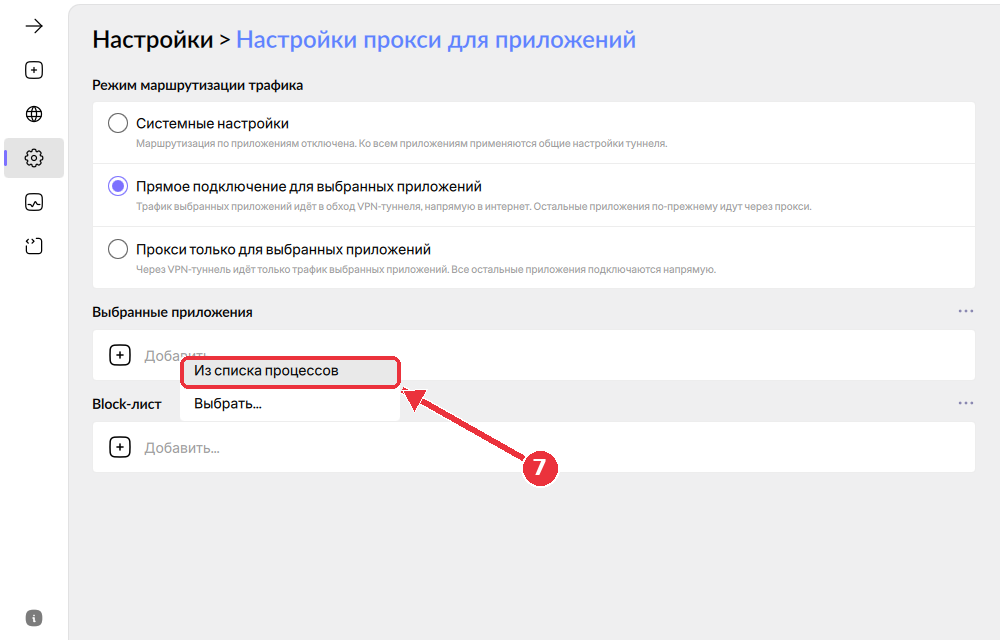
*Шаг 7: выбираем способ добавления*

**7.** Если торрент-клиент запущен, выберите **Из списка процессов**. Если нет — **Выбрать…** и укажите сам файл программы, а не ярлык: на Windows обычно `C:\Program Files\qBittorrent\qbittorrent.exe`, на Mac — `qBittorrent.app` или `Transmission.app` в «Программах».

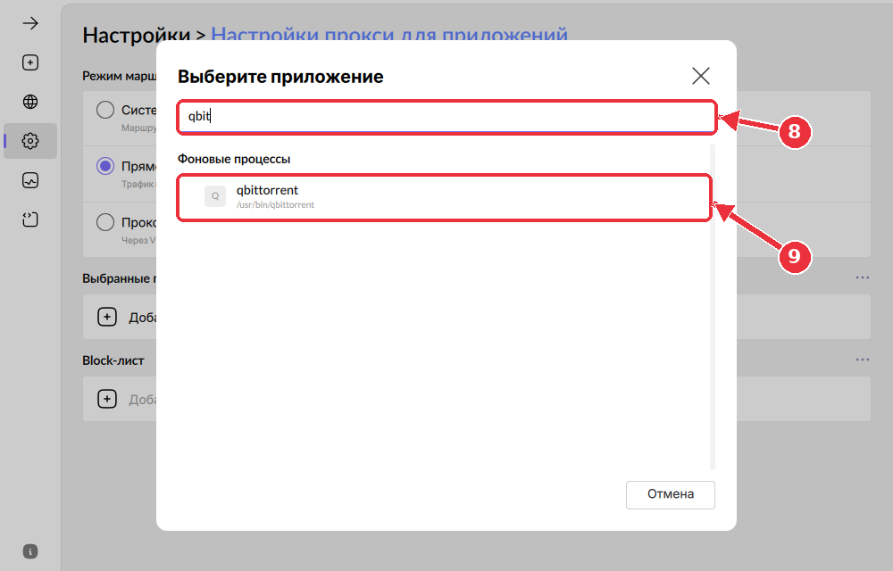
*Шаги 8–9: находим торрент-клиент*

**8.** Начните вводить название клиента в поиске, например `qbit`.  
**9.** Нажмите на найденный процесс.

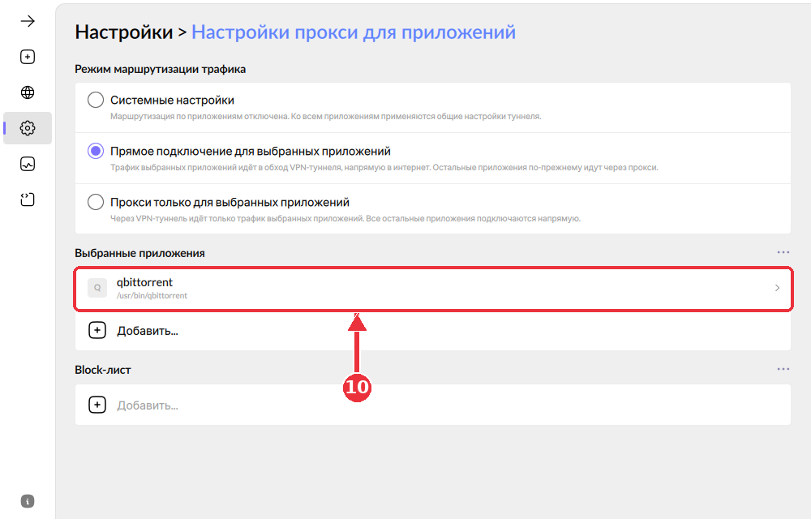
*Шаг 10: клиент добавлен*

**10.** Клиент появился в списке «Выбранные приложения». Теперь **отключите и снова подключите VPN** и **перезапустите торрент-клиент**.

> Скриншоты сделаны в Happ 4.8.3 для Linux. На Windows и macOS экраны те же, отличается только путь к программе. На Mac нужна версия Happ с сайта (DMG): в версии из App Store выбора приложений нет.

---

## INCY на компьютере (Windows, macOS, Linux)

Нужна версия INCY не ниже 3.6.0: в 3.3.3–3.5.0 выбор приложений на компьютере работал с ошибкой. На Windows запускайте INCY от имени администратора.

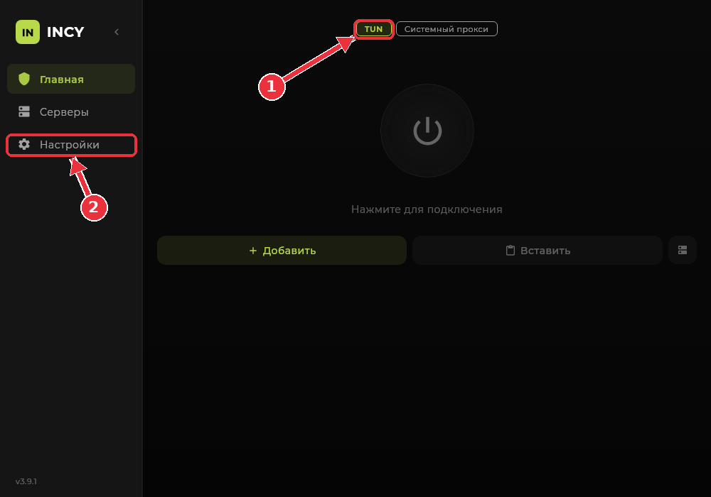
*Шаги 1–2: режим TUN и вход в настройки*

**1.** На главном экране вверху выберите режим **TUN**.  
**2.** Откройте **Настройки** в меню слева.

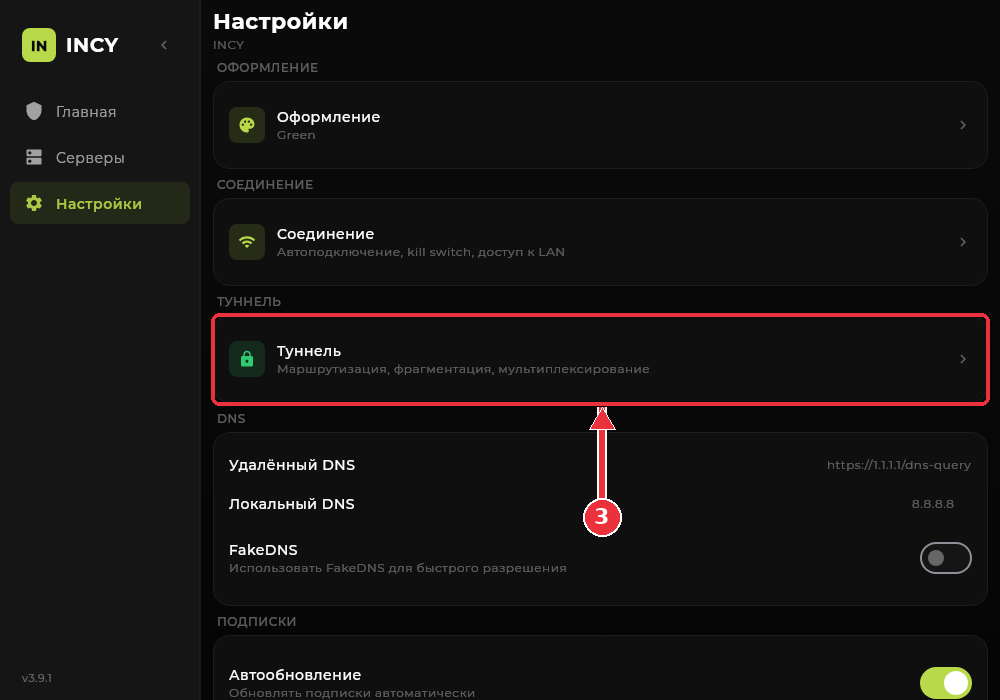
*Шаг 3: раздел «Туннель»*

**3.** Откройте раздел **Туннель**.

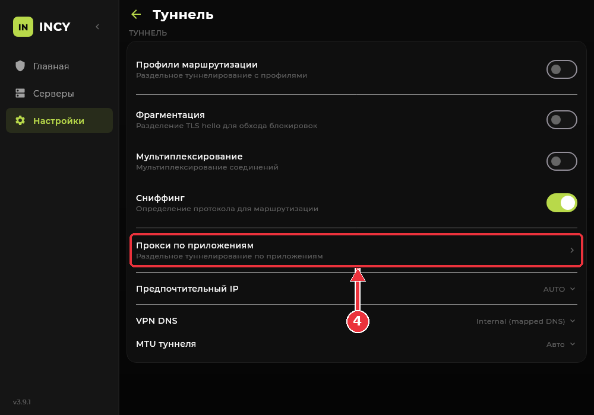
*Шаг 4: прокси по приложениям*

**4.** Нажмите **Прокси по приложениям**.

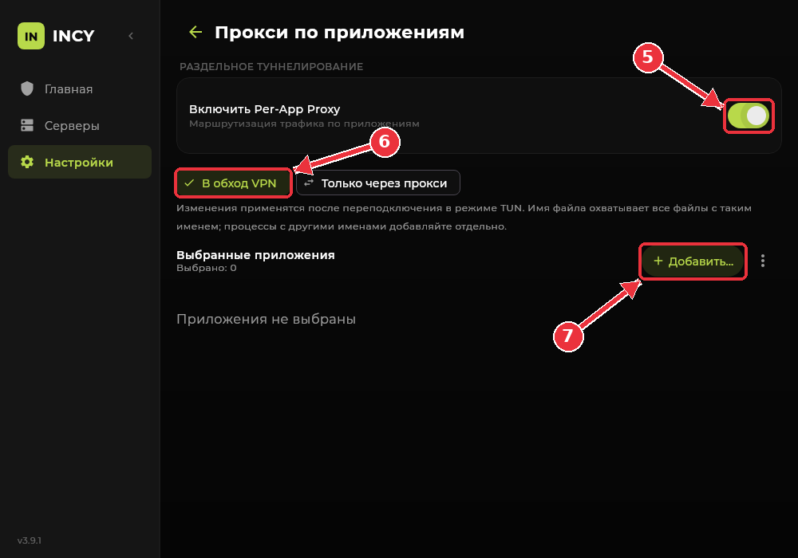
*Шаги 5–7: включаем и выбираем режим «В обход VPN»*

**5.** Включите переключатель **Включить Per-App Proxy**.  
**6.** Выберите режим **В обход VPN**. «Только через прокси» — обратный режим, он не нужен.  
**7.** Нажмите **Добавить…**

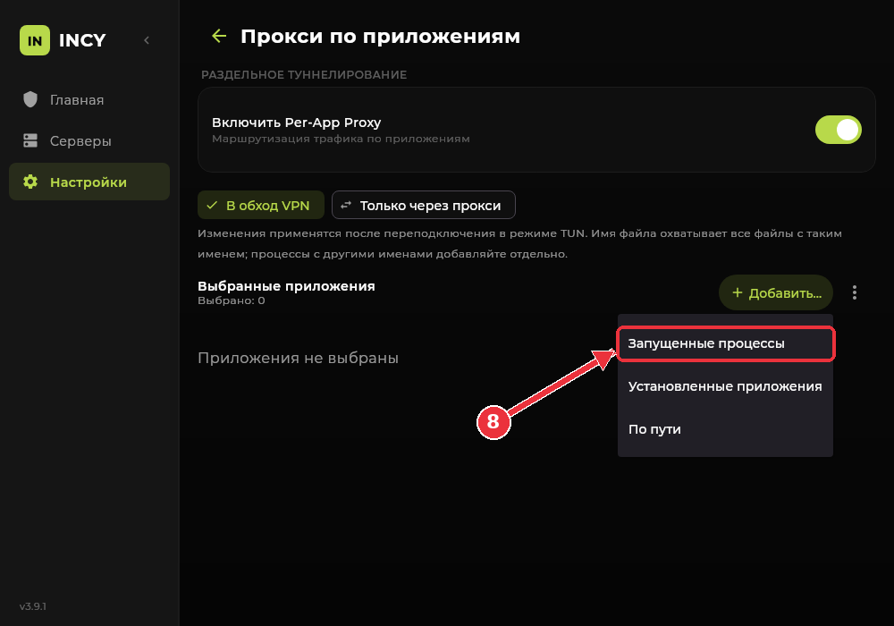
*Шаг 8: выбираем способ добавления*

**8.** Если торрент-клиент запущен, выберите **Запущенные процессы**. Можно также найти его в «Установленных приложениях» или указать файл через «По пути».

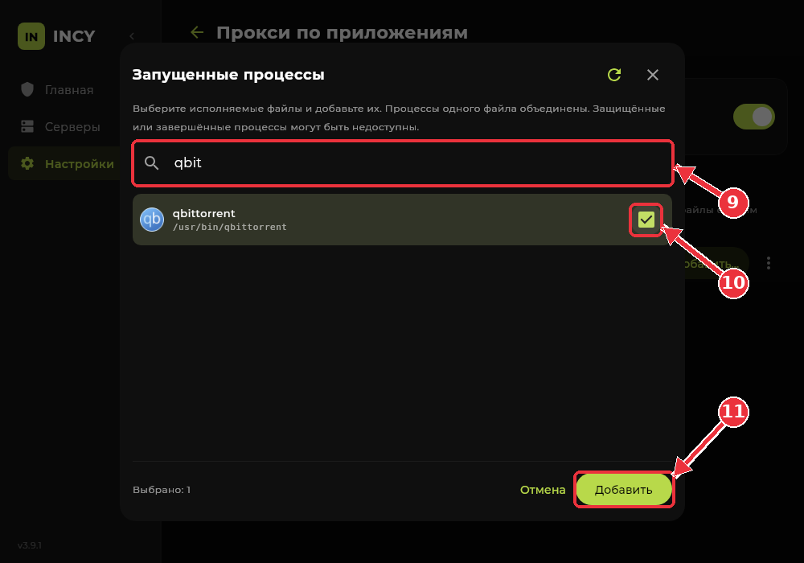
*Шаги 9–11: отмечаем торрент-клиент*

**9.** Введите в поиске название клиента, например `qbit`.  
**10.** Поставьте галочку напротив него.  
**11.** Нажмите **Добавить**.

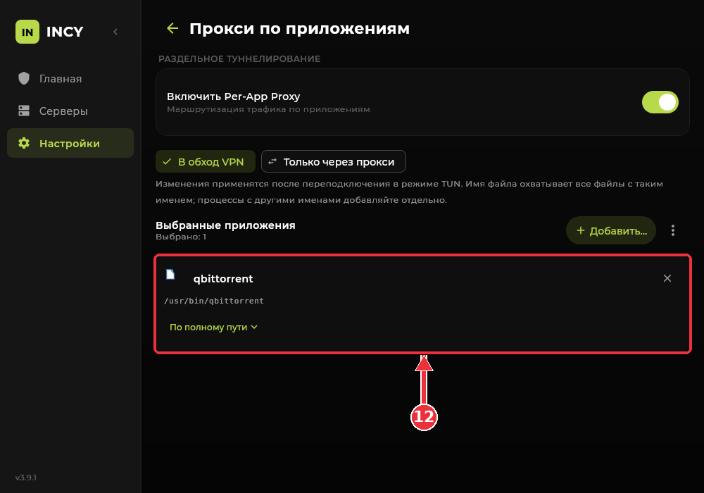
*Шаг 12: клиент в списке*

**12.** Клиент появился в списке. Изменения вступают в силу после переподключения в режиме TUN — **отключите и снова подключите VPN**, затем **перезапустите торрент-клиент**.

> Если с сервером «AUTO» исключение не срабатывает, выберите конкретный сервер. Скриншоты сделаны в INCY 3.9.1 для Linux.

---

## Happ на Android

1. Откройте Happ и нажмите значок ⚙ (Настройки).
2. В разделе «Настройки туннеля» откройте **Прокси для выбранных приложений** (в новых версиях пункт может называться «Настройки прокси для приложений», как на компьютере).
3. Перейдите на вкладку **Обход**. Вкладка «Выкл» пускает через VPN все приложения, «ВКЛ» — только отмеченные.
4. Отметьте торрент-клиент (LibreTorrent, Flud, µTorrent, BitTorrent и т. п.). Если его нет в списке, воспользуйтесь поиском.
5. Отключите и снова включите VPN.
6. Остановите торрент-клиент (Настройки Android → Приложения → клиент → «Остановить») и запустите заново.

## INCY на Android

1. Откройте INCY → **Настройки**.
2. Найдите пункт **Прокси по приложениям** (обычно в разделе «Туннель»).
3. Включите его и выберите режим **В обход VPN** (исключить выбранные).
4. Отметьте торрент-клиент.
5. Переподключите VPN и перезапустите торрент-клиент.

На Android исключённое приложение вообще не попадает в туннель, поэтому правила маршрутизации на него не влияют.

---

## iPhone и iPad

На iOS выбирать приложения нельзя ни в Happ, ни в INCY. Что можно сделать:

- отключать VPN на время скачивания;
- качать торренты на компьютере или Android.

Исключить торрент через «Маршрутизацию» не получится: правила по сайтам и IP покроют разве что трекер, а обмен с другими участниками раздачи всё равно пойдёт через VPN.

---

## Как проверить, что торрент идёт напрямую

1. Подключите VPN и откройте в браузере [ipleak.net](https://ipleak.net/). Вверху будет IP VPN-сервера.
2. В блоке **Torrent Address detection** нажмите **Activate** — появится magnet-ссылка на тестовый файл.
3. Откройте её в торрент-клиенте. Ничего не скачается: сайт только запишет, с какого адреса пришёл клиент.
4. Через 10–30 секунд в этом блоке появится IP торрент-клиента.
5. Если IP торрента — ваш обычный адрес, а у браузера — адрес VPN, всё настроено верно. Если оба адреса — от VPN, торрент всё ещё идёт через туннель.
6. Удалите тестовую раздачу из клиента.

## Если не работает

- **Торрент всё равно идёт через VPN.** Проверьте, что выбран режим «Прямое подключение» / «В обход VPN» / «Обход», а не обратный. Переподключите VPN и перезапустите клиент целиком, включая трей.
- **На компьютере ничего не меняется.** Включите режим TUN и запустите VPN-клиент от имени администратора. Проверьте, что добавлен файл программы, а не ярлык.
- **Торрент не качает совсем.** Снимите в клиенте привязку к интерфейсу VPN и прокси. На Android проверьте «Настройки → Сеть → VPN → ⚙ → Блокировать соединения без VPN»: с этим флажком исключённые приложения могут остаться без сети.
- **Галочки сбрасываются после обновления подписки.** Список приложений может задавать сам VPN-сервис в подписке. Напишите в его поддержку.
- **На Mac в Happ нет нужного пункта.** Поставьте версию с сайта (DMG) вместо версии из App Store.
